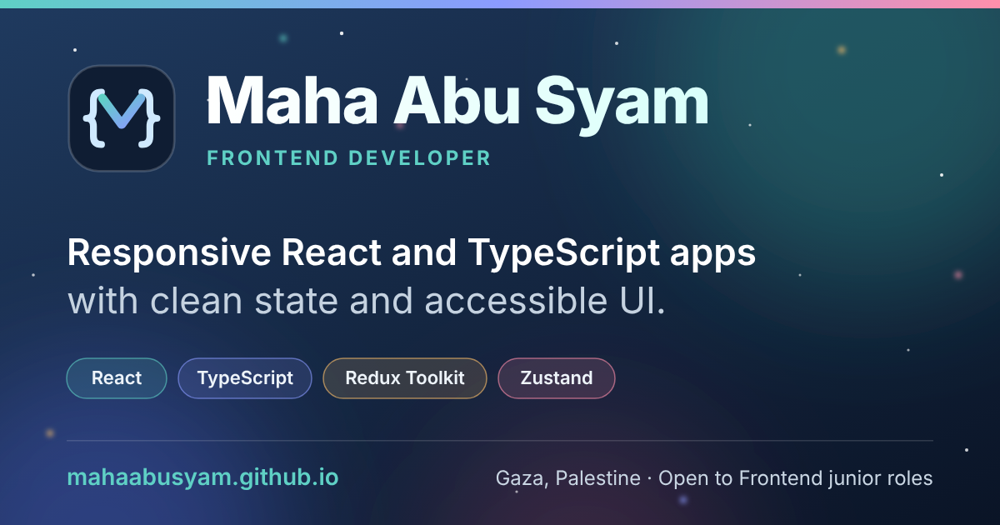

<div align="center">

# Maha Abu Syam · Portfolio

**Personal portfolio of a Frontend Developer: React, TypeScript and a lot of care for the details.**

[](https://mahaabusyam.github.io/)

[](https://github.com/mahaabusyam/mahaabusyam.github.io/actions/workflows/deploy.yml)


<!-- TODO: take a screenshot of the live site, save it as docs/preview.png -->


</div>

## About this project

A single-page portfolio that presents my projects, skills and experience. I built it from scratch (no template, no UI kit) to practice component design, typed data, CSS animation and deployment, and to have one place that links everything I have built.

**Live:** https://mahaabusyam.github.io/

## Highlights

- **Component-based architecture.** Every section (Hero, Projects, About, Experience, Contact) is its own React component with its own stylesheet.
- **Typed content.** Projects, skills, experience and profile info live in `src/data/` as TypeScript objects checked against interfaces in `src/types.ts`. Adding a project means adding one object, not touching the layout.
- **Motion with CSS only.** An animated starry background (twinkling stars, shooting stars, drifting aurora), a running border light around cards, and scroll-triggered entrance animations using `animation-timeline: view()`. No animation library and no scroll listeners.
- **Design tokens.** Colors, radii, fonts and spacing are CSS variables in `src/styles/tokens.css`.
- **Accessible by default.** Semantic landmarks, visible keyboard focus, descriptive `alt` and `aria-label` text, decorative elements hidden from screen readers, and `prefers-reduced-motion` support that turns animations off.
- **Responsive.** Fluid layouts that work from phones to wide desktops.
- **Link previews.** Open Graph and Twitter meta tags with a 1200×630 preview image.
- **Automatic deployment.** A GitHub Actions workflow builds and publishes to GitHub Pages on every push to `main`.

## Tech stack

| Area | Tools |
|---|---|
| Framework | React, TypeScript |
| Build tool | Vite |
| Styling | Plain CSS (custom properties, grid, flexbox, `color-mix`) |
| Hosting / CI | GitHub Pages, GitHub Actions |

## Getting started

Requirements: Node.js 20 or newer and npm.

```bash
# clone and install
git clone https://github.com/mahaabusyam/mahaabusyam.github.io.git
cd mahaabusyam.github.io
npm install

# start the dev server (http://localhost:5173)
npm run dev
```

### Scripts

| Command | What it does |
|---|---|
| `npm run dev` | Starts the development server with hot reload |
| `npm run build` | Type-checks and builds the production bundle into `dist/` |
| `npm run preview` | Serves the production build locally |
| `npm run lint` | Runs ESLint |

## Project structure

```text
.
├── .github/workflows/deploy.yml   # build + deploy to GitHub Pages
├── public/                        # static files: favicon, photo, CV, preview image
├── src/
│   ├── components/                # Hero, Projects, About, Experience, Contact, ...
│   ├── data/                      # typed content: profile, projects, skills, experience
│   ├── styles/                    # tokens.css, global.css, scroll.css
│   ├── types.ts                   # interfaces for the data files
│   ├── App.tsx                    # page composition
│   └── main.tsx                   # entry point
└── index.html                     # meta tags, Open Graph, fonts
```

## Customizing the content

All text on the site comes from `src/data/`:

| File | Controls |
|---|---|
| `profile.ts` | Name, title, location, email, social links, CV path, about text |
| `projects.ts` | Project cards (title, description, stack, links, colors, icon) |
| `skills.ts` | Skill groups and the colored dot of each skill |
| `experience.ts` | Experience entries, linked projects, certificate |

To add a project, add an object to the array in `projects.ts`. TypeScript will tell you if a field is missing or has the wrong type.

Colors and fonts can be changed in one place: `src/styles/tokens.css`.

## Deployment

The site is deployed with GitHub Actions (`.github/workflows/deploy.yml`):

1. Push to `main`.
2. The workflow runs `npm ci` and `npm run build`.
3. The `dist/` folder is published to GitHub Pages.

One-time setup: in the repository go to **Settings → Pages** and set **Source** to **GitHub Actions**. The repository is named `mahaabusyam.github.io`, so the site is served from the root URL and no `base` path is needed.

## Browser support

Everything works in current versions of Chrome, Edge, Firefox and Safari. The scroll-triggered animations use `animation-timeline`, which is not available everywhere yet. In browsers without it the content simply appears without the entrance animation.

## Contact

- Email: maha.abu.syam@gmail.com
- LinkedIn: https://www.linkedin.com/in/eng-maha-ahmed-abu-syam-365089405
- GitHub: https://github.com/mahaabusyam

## License

© Maha Ahmed Abu Syam. All rights reserved. The code is public so you can see how the site is built. Please do not reuse the design or content as your own portfolio.